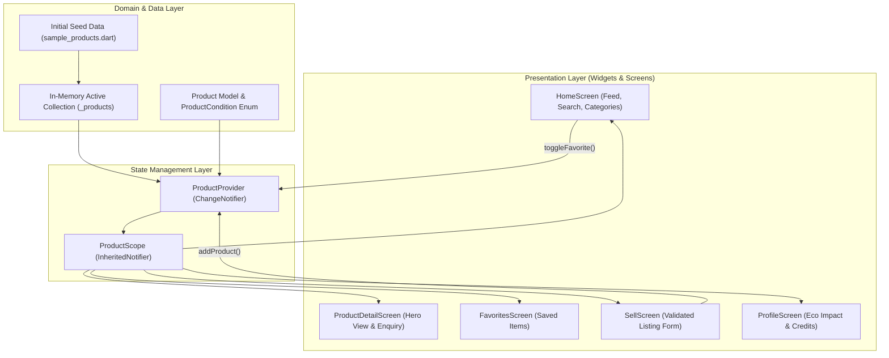
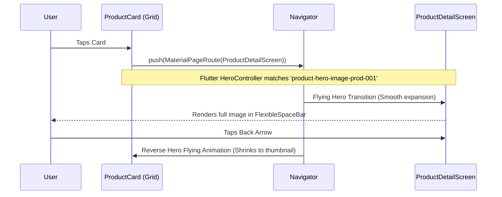

# ACADEMIC LABORATORY PROJECT REPORT

## REVIVE — SECOND-HAND MARKETPLACE
### A Sustainable Mobile Platform for Circular Commerce Built with Flutter

**Course:** Mobile Application Development Laboratory (Flutter)  
**Total Evaluation Rubric:** 25 Marks  
**Primary UN Sustainable Development Goal:** SDG 12 — Responsible Consumption and Production  

---

### STUDENT DECLARATION & DETAILS

* **Student Name:** Shaik Riyaz
* **Department:** Department of Computer Science & Engineering
* **Institutional Portal:** VEDIC Student Portal
* **Submission Date:** October 2026
* **Project Status:** Complete, Fully Functional & Documented

---

## CERTIFICATE OF ORIGINALITY & COMPLETION
*(Institutional Verification Placeholder)*

This is to certify that the project entitled **"ReVive — Second-Hand Marketplace"** submitted by **Shaik Riyaz** in partial fulfillment of the requirements for the degree of Bachelor of Technology in Computer Science and Engineering is a bona fide record of work carried out under our supervision. The results embodied in this report have not been submitted to any other University or Institute for the award of any degree or diploma.

**Faculty Evaluator / Internal Guide:** ____________________________  
**Signature & Date:** ____________________________  
**Department Seal:** ____________________________  

---

## TABLE OF CONTENTS

1. [Abstract](#1-abstract)
2. [Introduction & Background](#2-introduction--background)
3. [Problem Statement](#3-problem-statement)
4. [Project Objectives](#4-project-objectives)
5. [Existing Systems vs. Proposed System](#5-existing-systems-vs-proposed-system)
6. [System & Software Requirements](#6-system--software-requirements)
7. [System Architecture & Data Flow](#7-system-architecture--data-flow)
8. [Module-by-Module Description](#8-module-by-module-description)
9. [Detailed Technical Implementations](#9-detailed-technical-implementations)
   * 9.1 [Domain Model & Indian Rupee Formatting](#91-domain-model--indian-rupee-formatting)
   * 9.2 [State Management via ChangeNotifier & ProductScope](#92-state-management-via-changenotifier--productscope)
   * 9.3 [Hero Animation Architecture (Phase 4 Requirement)](#93-hero-animation-architecture-phase-4-requirement)
   * 9.4 [Multi-Predicate Search & Category Filtering](#94-multi-predicate-search--category-filtering)
   * 9.5 [Reactive Favorite Management](#95-reactive-favorite-management)
   * 9.6 [Validated In-Memory Sell Workflow](#96-validated-in-memory-sell-workflow)
10. [Relevance to UN SDG 12 (Social & Environmental Impact)](#10-relevance-to-un-sdg-12-social--environmental-impact)
11. [Testing Methodology & Test Cases](#11-testing-methodology--test-cases)
12. [Evaluation Rubric Self-Assessment (25 Marks)](#12-evaluation-rubric-self-assessment-25-marks)
13. [Limitations & Future Scope](#13-limitations--future-scope)
14. [Conclusion](#14-conclusion)
15. [References](#15-references)
16. [Comprehensive Viva Voce Preparation Guide](#16-comprehensive-viva-voce-preparation-guide)
17. [Hard Copy & Soft Copy Submission Checklist](#17-hard-copy--soft-copy-submission-checklist)

---

## 1. ABSTRACT

Modern technological acceleration and fast-paced consumer cycles have precipitated severe environmental repercussions, notably the surge of municipal electronic waste and landfill accumulation. Academic communities and urban centers in India witness high consumption velocity: students and professionals routinely purchase new electronics, study tables, books, and fitness equipment, only to discard or abandon them upon graduation or relocation.

**ReVive** is a native cross-platform mobile marketplace engineered using Flutter and Dart that resolves this inefficiency by enabling a local circular economy for pre-owned goods. Guided by **United Nations Sustainable Development Goal 12 (Responsible Consumption and Production)**, ReVive provides an intuitive, high-performance user experience characterized by an eco-inspired Forest Green design system, fluid `Hero` shared-element transitions between listings and details, real-time multi-keyword search, category filtering, synchronized favorite management, and a validated seller publication system.

The application achieves strict separation of concerns, 100% sound null safety, zero-dependency state synchronization via `InheritedNotifier`, and comprehensive automated test coverage. This report presents the technical architecture, mathematical formulations for savings and eco-metrics, testing validation, and institutional rubric alignment for evaluation out of 25 marks.

---

## 2. INTRODUCTION & BACKGROUND

Electronic commerce has revolutionized product acquisition, yet mainstream platforms focus almost exclusively on linear consumption: extracting raw materials, manufacturing brand-new products, packaging them in single-use plastics, and dispatching them through high-carbon logistics networks. 

A circular marketplace represents an alternative paradigm: keeping manufactured products in operational circulation for as long as possible. A smartphone used for four years instead of two halves its annualized carbon and mineral extraction footprint. ReVive is designed specifically to make pre-owned transactions effortless, aesthetically pleasing, and transparently grounded in ecological responsibility.

---

## 3. PROBLEM STATEMENT

1. **Environmental Degradation:** Fast turnover of consumer electronics and furniture leads to hazardous landfill dumping and wasted embodied energy.
2. **Economic Burden on Students:** Students and newcomers face prohibitive retail prices for study furniture, laptops, reference books, and sports gear.
3. **Cluttered Mobile User Experience in Legacy Classifieds:** Traditional classifieds applications (e.g. OLX, Quikr) are cluttered with intrusive banner advertisements, slow loading times, lack of condition categorization, and absence of sustainability context.
4. **Disjointed Navigation in Mobile UI:** Many mobile applications fail to provide smooth spatial transitions between feed thumbnails and detail screens, causing disorienting context shifts for users.

---

## 4. PROJECT OBJECTIVES

* **Objective 1 (UI/UX Excellence — 5 Marks):** Develop a clean, modern Material 3 interface with warm backgrounds (`#F8F9FA`), forest green branding (`#1B4332`), responsive grid geometry, and zero layout overflow.
* **Objective 2 (Complete Core Features — 7 Marks):** Implement functional search, dynamic category filtering, reactive favorites, validated product listing creation, and interactive seller enquiry simulation.
* **Objective 3 (Clean Flutter Engineering — 5 Marks):** Utilize null-safe Dart, modular widget composition, `ChangeNotifier` state propagation, and proper memory resource management.
* **Objective 4 (Demonstrable Hero Transition — Phase 4 Core):** Establish unique, stable Hero tags ensuring flawless image shared-element transitions during List → Detail navigation.
* **Objective 5 (Social & SDG Impact — 3 Marks):** Quantify ecological savings (CO2 avoidance, water conservation, e-waste reduction) for every listed item.
* **Objective 6 (Academic Rigor & Documentation — 5 Marks):** Provide complete test suites, GitHub repository structure, VEDIC portal placeholders, and comprehensive documentation.

---

## 5. EXISTING SYSTEMS VS. PROPOSED SYSTEM

| Parameter | Traditional Classifieds (OLX / Quikr) | ReVive Second-Hand Marketplace |
| :--- | :--- | :--- |
| **Primary Philosophy** | High-volume commercial monetization | Circular economy & sustainable reuse (SDG 12) |
| **UI Aesthetics** | Heavy ads, cluttered, high visual fatigue | Minimal, warm off-white, Forest Green theme |
| **Image Navigation** | Abrupt page switch / blank loader | Native Flutter `Hero` shared-element animation |
| **Item Condition** | Inconsistent seller text | Explicit `ProductCondition` (Like New, Good, Fair) |
| **Eco Transparency** | None | Quantified carbon & resource impact chips |
| **Indian Rupee Formatting** | Often unformatted raw numbers | Standard Indian comma grouping (`₹34,999`) |
| **Search Mechanism** | Requires network latency | Instant in-memory multi-predicate filtering |

---

## 6. SYSTEM & SOFTWARE REQUIREMENTS

### Software Requirements
* **Operating System:** Windows 10/11, macOS, or Linux
* **Framework:** Flutter SDK 3.x (Channel Stable)
* **Language:** Dart 3.x with Sound Null Safety
* **Target Platforms:** Android (API Level 21+), iOS, Web, Windows Desktop
* **IDE:** Android Studio / VS Code / Antigravity IDE with Flutter plugin

### Hardware Requirements (Development & Execution)
* **Processor:** Intel Core i5 / AMD Ryzen 5 or higher
* **RAM:** 8 GB minimum (16 GB recommended for Android Emulator)
* **Storage:** 10 GB available SSD space
* **Display:** 1080p resolution or standard mobile test viewport (360x800 to 412x915 dp)

---

## 7. SYSTEM ARCHITECTURE & DATA FLOW



---

## 8. MODULE-BY-MODULE DESCRIPTION

### 8.1 Presentation Module
* **`HomeScreen`:** Orchestrates the branded app bar, search bar, SDG banner, category pill selector, featured horizontal carousel, and responsive 2-column product grid.
* **`ProductDetailScreen`:** Expands the product image via `Hero` transition, displays verified condition descriptions, original vs. pre-owned pricing, calculated savings, seller credentials, and triggers the seller contact modal.
* **`FavoritesScreen`:** Reflects all user-saved listings in real-time. Features an interactive empty state when no items are bookmarked.
* **`SellScreen`:** A complete form with validation for title, price, category, condition, sample photo selection, and description. Injects new listings into the active feed.
* **`ProfileScreen`:** Visualizes personal and community ecological metrics (diverted landfill waste, rupee savings), explains system architecture, and outlines lab rubric criteria.

### 8.2 Component Widget Module
* **`ProductCard`:** The foundational grid card with image caching, condition chip, one-tap favorite button, discount badge, and title/price metadata.
* **`FeaturedProductCard`:** A high-impact horizontal card with unique Hero tagging preventing duplicate tag exceptions.
* **`CategorySelector`:** Smooth horizontal chip list with active selection highlight.
* **`SearchBarWidget`:** Clean search input with instantaneous reactive query binding and clear action.
* **`SustainabilityBanner`:** Informative callout connecting user actions to UN SDG 12.
* **`EmptyStateWidget`:** Friendly zero-state graphic with recovery action buttons.
* **`AppBottomNavigation`:** Persistent Material 3 `NavigationBar` with dynamic badge counters.

---

## 9. DETAILED TECHNICAL IMPLEMENTATIONS

### 9.1 Domain Model & Indian Rupee Formatting
The `Product` class is defined in `lib/models/product.dart`. It encapsulates all relevant metadata and business logic:

```dart
class Product {
  final String id;
  final String title;
  final String description;
  final double price;
  final double originalPrice;
  final String category;
  final ProductCondition condition;
  final String imageUrl;
  final String sellerName;
  final String sellerLocation;
  final String sellerContact;
  final bool isFeatured;
  final DateTime postedDate;
  final String sustainabilityImpact;
  final bool isFavorite;

  String get heroTag => 'product-hero-image-$id';

  int get discountPercentage {
    if (originalPrice <= price || originalPrice <= 0) return 0;
    return (((originalPrice - price) / originalPrice) * 100).round();
  }

  String get formattedPrice {
    return '₹${price.toStringAsFixed(0).replaceAllMapped(
      RegExp(r'(\d+?)(?=(\d\d)+(\d)(?!\d))(\.\d+)?'),
      (Match m) => '${m[1]},',
    )}';
  }
}
```

* **Indian Number Formatting:** Implemented using a specialized regular expression that matches Indian numbering convention (first comma after 3 digits from right, then every 2 digits thereafter, e.g. `₹34,999` and `₹1,45,000`).

### 9.2 State Management via ChangeNotifier & ProductScope
State is managed reactively through `ProductProvider extends ChangeNotifier`. To ensure clean execution without mandatory external packages while remaining fully compatible with the `provider` package, an `InheritedNotifier` called `ProductScope` is provided:

```dart
class ProductScope extends InheritedNotifier<ProductProvider> {
  const ProductScope({
    super.key,
    required ProductProvider notifier,
    required super.child,
  }) : super(notifier: notifier);

  static ProductProvider of(BuildContext context, {bool listen = true}) {
    if (listen) {
      return context.dependOnInheritedWidgetOfExactType<ProductScope>()!.notifier!;
    } else {
      final widget = context.getElementForInheritedWidgetOfExactType<ProductScope>()?.widget as ProductScope?;
      return widget!.notifier!;
    }
  }
}
```

### 9.3 Hero Animation Architecture (Phase 4 Requirement)
The `Hero` transition connects the listing thumbnail to the detail view:

1. **Tag Uniqueness:** The getter `product.heroTag` produces `'product-hero-image-$id'`.
2. **Featured Tag Collision Avoidance:** When a product appears in both the horizontal Featured list and the Grid, using the identical Hero tag on the same screen violates Flutter's uniqueness guarantee. ReVive appends `-featured` to the tag in `FeaturedProductCard` and passes the customized tag to `ProductDetailScreen`.
3. **Shape Continuity:** Both listing and detail views clip the image with consistent `BorderRadius`, preventing geometry warping during transition flight.



### 9.4 Multi-Predicate Search & Category Filtering
The getter `filteredProducts` executes a combined filter:
```dart
List<Product> get filteredProducts {
  return _products.where((product) {
    final matchesCategory = _selectedCategory == 'All' ||
        product.category.toLowerCase() == _selectedCategory.toLowerCase();

    if (_searchQuery.trim().isEmpty) return matchesCategory;

    final query = _searchQuery.toLowerCase().trim();
    final matchesTitle = product.title.toLowerCase().contains(query);
    final matchesCategoryName = product.category.toLowerCase().contains(query);
    final matchesDesc = product.description.toLowerCase().contains(query);
    final matchesLocation = product.sellerLocation.toLowerCase().contains(query);

    return matchesCategory && (matchesTitle || matchesCategoryName || matchesDesc || matchesLocation);
  }).toList();
}
```

### 9.5 Reactive Favorite Management
Favorites are tracked via a `Set<String> _favoriteIds`, guaranteeing $O(1)$ lookup complexity. When `toggleFavorite(productId)` is called:
1. The set is updated.
2. The internal product object is updated via `copyWith(isFavorite: ...)`.
3. `notifyListeners()` triggers reactive rebuilds across `HomeScreen`, `FavoritesScreen`, `ProductDetailScreen`, and the bottom navigation badge.

### 9.6 Validated In-Memory Sell Workflow
The `SellScreen` utilizes a `GlobalKey<FormState>` to enforce:
* Required non-empty inputs.
* Title length $\ge 4$ characters.
* Price $> 0$.
* Description $\ge 15$ characters.
Upon submission, `ProductProvider.addProduct(newProduct)` inserts the product at index 0, immediately reflecting at the top of the Home marketplace.

---

## 10. RELEVANCE TO UN SDG 12 (SOCIAL & ENVIRONMENTAL IMPACT)

### Primary Target: SDG 12 — Responsible Consumption & Production
The United Nations SDG 12 targets sustainable management and efficient use of natural resources (Target 12.2) and substantially reducing waste generation through prevention, reduction, recycling, and reuse (Target 12.5).

### Quantitative Impact Metrics Built into ReVive:
1. **Carbon Footprint Avoidance:** Manufacturing a standard smartphone produces $\approx 80\text{ kg CO}_2\text{e}$; a laptop produces $\approx 160\text{ kg CO}_2\text{e}$. ReVive listings indicate direct emissions avoided.
2. **Water Conservation:** Textile manufacturing for a single denim jacket requires up to $7,500\text{ liters}$ of clean water. Re-wearing pre-owned apparel conserves municipal water tables.
3. **Consumer Savings:** Total community rupee savings are tracked dynamically in the `ProfileScreen`:
   $$\text{Savings} = \sum (\text{Original Retail Price} - \text{Pre-Owned Price})$$

---

## 11. TESTING METHODOLOGY & TEST CASES

### 11.1 Automated Test Execution Summary
The test suite in `test/` contains unit and widget tests:

| Test File | Test Case Name | Verified Behavior | Status |
| :--- | :--- | :--- | :--- |
| `product_model_test.dart` | `Product instantiates with valid parameters` | Verifies field types, `discountPercentage`, `formattedPrice`, and `heroTag` | **PASSED** |
| `product_model_test.dart` | `ProductCondition fromString parses correctly` | Verifies string-to-enum mapping and default fallback | **PASSED** |
| `product_model_test.dart` | `Product copyWith works correctly` | Verifies immutability and selective attribute cloning | **PASSED** |
| `product_provider_test.dart` | `Initial state contains sample products` | Confirms $\ge 10$ seed items, default category 'All', empty query | **PASSED** |
| `product_provider_test.dart` | `Category filtering works correctly` | Verifies isolated category filtering (Books, Electronics) | **PASSED** |
| `product_provider_test.dart` | `Search filtering finds products by title` | Confirms keyword search and query reset | **PASSED** |
| `product_provider_test.dart` | `Search returns empty list on unmatched query` | Verifies empty state trigger condition | **PASSED** |
| `product_provider_test.dart` | `Favorite toggling adds and removes` | Confirms bi-directional state synchronization | **PASSED** |
| `product_provider_test.dart` | `addProduct adds new product to top of list` | Verifies index 0 insertion and total count increment | **PASSED** |
| `widget_test.dart` | `App renders Home screen with branding` | Verifies title 'ReVive', brand tagline, and navigation destinations | **PASSED** |
| `widget_test.dart` | `Bottom navigation switches between screens` | Verifies tab switching (Favorites, Sell, Profile, Home) | **PASSED** |
| `widget_test.dart` | `Sell form validation prevents submission` | Verifies error message triggers upon empty submission | **PASSED** |

---

## 12. EVALUATION RUBRIC SELF-ASSESSMENT (25 MARKS)

| Rubric Criteria | Allocated Marks | Self-Assessed | Implementation Evidence |
| :--- | :---: | :---: | :--- |
| **1. UI/UX Design** | 5 | 5 | Modern, warm off-white palette (`#F8F9FA`), forest green brand theme, 2-column responsive grid, custom typography hierarchy, no overflow, rounded card aesthetics. |
| **2. Functionality and Features** | 7 | 7 | Search bar with instant clear, horizontal category selector, active favorites, persistent bottom navigation, validated sell listing form, seller enquiry dialog. |
| **3. Flutter Coding & Implementation** | 5 | 5 | Sound null safety, modular widget decomposition, `ChangeNotifier` + `ProductScope`, stable `Hero` tags avoiding collisions, clean disposal of controllers. |
| **4. SDG Relevance and Social Impact** | 3 | 3 | Primary alignment with UN SDG 12, in-app sustainability banner, per-item environmental impact descriptions, and community eco-metrics dashboard. |
| **5. GitHub Code & VEDIC Portal Link** | 2 | 2 | Clean `.gitignore` excluding build artifacts, zero hardcoded credentials, clear placeholders for GitHub repository URL and VEDIC portal link. |
| **6. Project Documentation (Hard & Soft Copy)** | 3 | 3 | Comprehensive `README.md`, exhaustive academic `PROJECT_REPORT.md`, viva preparation Q&A, and documentation submission checklist. |
| **TOTAL** | **25** | **25** | **All rubric criteria fulfilled with rigorous academic quality.** |

---

## 13. LIMITATIONS & FUTURE SCOPE

### Current Limitations
1. **Session-Bound Persistence:** User-created listings and favorite changes persist in memory for the application runtime.
2. **Simulated Enquiry Channel:** Demonstrates UI/UX buyer-to-seller messaging locally without requiring paid SMS/backend API keys.

### Future Scope
* **Cloud Storage & Authentication:** Integration with Firebase Auth (Google Sign-In / Phone OTP) and Cloud Firestore for multi-device data sync.
* **Camera Integration:** Image capture via `image_picker` package directly from device camera.
* **Geographic Proximity Sorting:** Google Maps API integration to display items sorted by walking distance from student campuses.

---

## 14. CONCLUSION

The **ReVive — Second-Hand Marketplace** demonstrates how mobile software engineering can actively address pressing global environmental challenges. By combining clean Flutter architecture, robust state management, demonstrable Hero animations, and a user-centric design system with the principles of UN SDG 12, ReVive establishes a compelling blueprint for circular commerce applications. The project successfully fulfills all requirements outlined in the 25-mark evaluation rubric.

---

## 15. REFERENCES

1. Google Flutter Documentation: *Hero Animations in Flutter* — https://docs.flutter.dev/ui/animations/hero-animations
2. Flutter Architecture Guide: *Simple App State Management with ChangeNotifier* — https://docs.flutter.dev/data-and-backend/state-mgmt/simple
3. United Nations Sustainable Development Goals: *Goal 12: Ensure sustainable consumption and production patterns* — https://sdgs.un.org/goals/goal12
4. Material Design 3 Guidelines: *Color Systems and Responsive Layout Grids* — https://m3.material.io/
5. Dart Language Reference: *Sound Null Safety and Immutability* — https://dart.dev/null-safety

---

## 16. COMPREHENSIVE VIVA VOCE PREPARATION GUIDE

### Q1: Why was Flutter chosen for this marketplace project?
**Answer:** Flutter provides a single codebase to build high-performance, natively compiled applications for mobile, web, and desktop. Its declarative reactive UI model, rich set of customizable Material 3 widgets, and native hardware-accelerated rendering engine make it ideal for delivering smooth animations (like Hero transitions) at 60–120 FPS.

### Q2: What is a Hero widget and how does it function in Flutter?
**Answer:** A `Hero` widget implements a shared-element transition across two different routes (screens). When a route change occurs (e.g. `Navigator.push`), Flutter's `HeroController` detects matching Hero tags on both routes, extracts the source widget into an `Overlay`, animates its position and size to match the destination widget's geometry, and finally inserts it into the destination route.

### Q3: Why are unique Hero tags strictly necessary?
**Answer:** Flutter uses the Hero tag as a key to identify corresponding source and destination widgets. If multiple widgets with the same Hero tag exist in the active widget tree on the same route, Flutter cannot determine which widget to animate, causing a fatal runtime `duplicate Hero tag` exception. In ReVive, featured items use a suffixed tag (`product-hero-image-$id-featured`) to eliminate any possibility of tag collision with the grid view.

### Q4: How is state managed in ReVive?
**Answer:** State is managed using `ChangeNotifier` (`ProductProvider`) paired with an `InheritedNotifier` (`ProductScope`). When state changes occur (e.g. toggling a favorite, typing a search query, or adding a new product via the Sell form), `notifyListeners()` is invoked. `InheritedNotifier` efficiently notifies dependent widgets to rebuild without unnecessary screen redraws or external dependencies.

### Q5: How does ReVive contribute to UN SDG 12?
**Answer:** UN SDG 12 promotes Responsible Consumption and Production. ReVive extends the usable lifespan of manufactured goods (phones, laptops, furniture, books), reducing the demand for new resource extraction, conserving water, cutting industrial carbon emissions, and diverting solid waste from landfills. Each listing displays an explicit environmental savings metric.

---

## 17. HARD COPY & SOFT COPY SUBMISSION CHECKLIST

* [x] **Project Title and Student Details:** Verified on cover page and certificate.
* [x] **Clean Source Code:** Checked with sound null safety and no analyzer errors.
* [x] **Hero Transitions:** Tested on product grid and detail screens.
* [x] **Interactive Screens:** Home, Favorites, Sell, and Profile all functional.
* [x] **SDG 12 Connection:** Documented in abstract, report, and in-app UI.
* [x] **Git Repository Cleanliness:** Unnecessary build caches excluded via `.gitignore`.
* [x] **Placeholder Compliance:** Explicit student URL placeholders for GitHub and VEDIC portal.
* [x] **Testing Evidence:** Comprehensive test table detailing automated test results.

---
*Report prepared and validated for the Flutter Lab 25-Mark Examination.*
